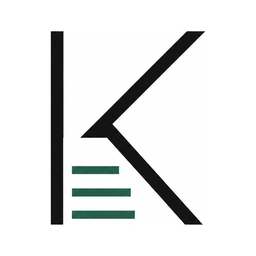

# Konspekt



Кроссплатформенное приложение (Windows 10/11 x64 и macOS 13+ arm64/x86_64) для превращения записей BigBlueButton в аккуратные учебные материалы. Оно локально скачивает необходимые дорожки записи, распознаёт речь и текст на экране, собирает контекст и помогает сохранить готовый `lesson.md`.

## Что работает локально

- импорт публичной BBB-записи по ссылке playback;
- извлечение аудио и кадров экрана через FFmpeg;
- транскрибация Faster-Whisper на компьютере;
- OCR кадров через Tesseract;
- контекст для ChatGPT или DeepSeek и сохранение итогового Markdown;
- вход через личный ChatGPT в изолированном окне (WebView2 на Windows, WKWebView на macOS) и автоматическое создание `lesson.md` доступной моделью Codex;
- прямое создание `lesson.md` через OpenAI или DeepSeek API по желанию;
- понятные этапы обработки, прошедшее время и возобновление после ошибки.

## Как этим учиться

1. **Добавь лекцию** (Ctrl+N): ссылка на запись BBB или аудио/видео файл. Можно сразу отметить «Подготовить» и «Потом создать конспект» — дальше всё произойдёт само, пока ты занимаешься другим.
2. **Читай конспект.** Слева оглавление, сверху прогресс чтения, место чтения запоминается. Таймкоды `[00:12:34]` кликабельны: включается запись лекции с этого места и кадр со слайдом. Ctrl+F — поиск по тексту, кнопки «A» — размер шрифта.
3. **Повторяй карточки.** Вопросы для самопроверки и термины из словаря автоматически становятся карточками. Пробел — показать ответ, 1 — «Не помню», 2 — «Помню». Интервалы растут сами (1 → 3 → 7 → 16 дней), а забытая карточка возвращается в тот же день; раздел «Повторение» собирает карточки из всех лекций на сегодня.
4. **Ищи по всем конспектам** (Ctrl+K) — найдёт и название лекции, и фразу внутри конспекта.
5. **Расшифровка** лекции доступна отдельной вкладкой с поиском и переходом к записи.

Конспект можно отредактировать и экспортировать в PDF, HTML, Markdown или ZIP-архив лекции.

Интерфейс сделан на HTML внутри нативного окна (pywebview: WebView2 на Windows, WKWebView на macOS), поддерживает светлую и тёмную тему. Если WebView недоступен, автоматически открывается прежний интерфейс на Tk; принудительно его можно запустить с флагом `--classic`.

Аудио, видео и кадры всегда остаются на компьютере. Базовая подготовка полностью локальна. Только после явного подтверждения в окне согласия приложение отправляет текстовый пакет: транскрипцию, текст слайдов и OCR-заметки; ссылка BBB и идентификатор записи из него удаляются. API-ключ защищается системным хранилищем (Windows Credential Manager / macOS Keychain) и не записывается открытым текстом в библиотеку или настройки.

Личный ChatGPT подключается через локально установленный Codex CLI и его [Experimental app-server](https://learn.chatgpt.com/docs/app-server). Konspekt показывает одно отдельное auth-окно (WebView2 в Windows, WKWebView в macOS) только для ручной авторизации OpenAI; DOM страницы, cookies и ответы ChatGPT не считываются. Интерфейс чата `chatgpt.com` внутри приложения не показывается. После входа приложение предлагает только доступные аккаунту модели Codex и не обещает набор обычных моделей ChatGPT.

По умолчанию Faster-Whisper использует более быструю модель `base`. В настройках можно выбрать `tiny`, `base` или более точную `small`. При первом использовании выбранная открытая модель скачивается один раз и не расходует API-токены.

## Быстрый старт для разработки

1. Установи Python 3.10+ и, если нужен вход через личный ChatGPT, [Codex CLI](https://learn.chatgpt.com/docs/developer-commands). Убедись, что команда `codex --version` доступна в PowerShell.
2. Выполни:

   ```powershell
   python -m venv .venv
   .\.venv\Scripts\python.exe -m pip install -e ".[local-ai]"
   .\.venv\Scripts\pythonw.exe -m konspekt
   ```

3. В приложении нажми «Добавить лекцию», вставь ссылку BBB или выбери файл. «Подготовить» расшифрует речь и слайды локально.
4. Нажми «Создать конспект» и выбери личный ChatGPT/Codex, OpenAI/DeepSeek API либо ручной режим через любой веб-чат (скопировать задание → вставить ответ). В окне видно, что именно отправляется, а что остаётся на компьютере.

`scripts\setup_local_ai.ps1` и `scripts\run_konspekt.bat` делают то же самое. Прямые команды выше пригодятся, если Windows запрещает запуск `.ps1`-сценариев.

Для OCR экрана установи Tesseract:

```powershell
winget install UB-Mannheim.TesseractOCR
```

Подробности: [локальная обработка](docs/local-ai.md).

## Готовая Windows-версия

Собери приложение командой:

```powershell
.\scripts\build_konspekt.ps1
```

Результат: `dist\Konspekt\Konspekt.exe`. Копируй всю папку `dist\Konspekt`, а не только `.exe`: рядом лежат FFmpeg, Tesseract, pywebview/pythonnet, локальные библиотеки и иконка приложения. Codex CLI и Microsoft Edge WebView2 Runtime устанавливаются отдельно. Инструкция для получателя: [docs/release.md](docs/release.md).

## Структура проекта

```text
src/konspekt/          исходный код приложения и BBB CLI
src/konspekt/web/      HTML-интерфейс: мост для JS (api.py), очередь задач, локальный сервер, static/
tests/                 модульные тесты
assets/                единая SVG, PNG и ICO-иконка Konspekt
scripts/               настройка, запуск, сборка и генерация иконки
packaging/             PyInstaller-спецификации
docs/                  инструкции по локальному ИИ и выпуску
pyproject.toml         зависимости и точки входа пакета
```

Основной запуск — `python -m konspekt` или команда `konspekt` после установки пакета. Корневые `study_app.py` и `bbb_import.py` оставлены только как короткие совместимые обёртки для старых запусков.

## Проверка

```powershell
$env:PYTHONDONTWRITEBYTECODE = '1'
$env:PYTHONPATH = "$PWD\src"
.\.venv\Scripts\python.exe -m unittest discover -s tests -v
```

## Дополнительная CLI-утилита

Старый BBB-загрузчик сохранён отдельно от интерфейса. Он скачивает запись и при необходимости собирает MP4:

```powershell
python -m konspekt.bbb_download "https://host/playback/presentation/2.0/playback.html?meetingId=..."
```

Для него есть отдельная сборка: `scripts\build_bbb_downloader.ps1`.
